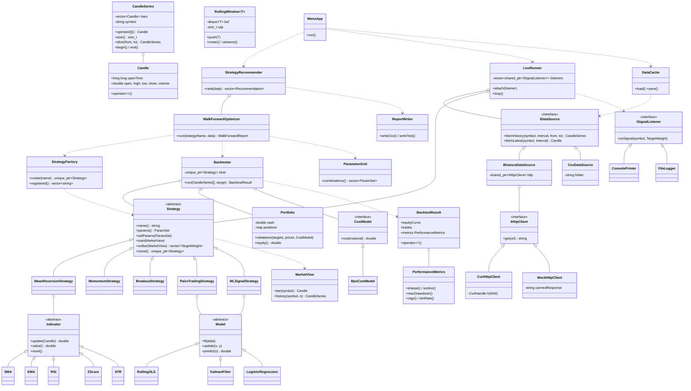

# AI Quant Trading & Statistical Arbitrage Engine: Architecture (Stage 1)

C++17, OOP. Data: Binance public market-data API (no key). Platform: Windows / MinGW (MSYS2 UCRT64). Interface: CLI menu.

> Companion files: `SPEC.md` (exact behaviour and tests, wins on behaviour), `TASKLIST.md` (work queue), `CLAUDE.md` (working rules), `DECISIONS.md`. This file is the plan; the build records any divergence in `DECISIONS.md` and an "As built" section added at the end (T6.3).

## 1. What the system does

1. **Fetches** historical candles (klines) from Binance and caches them to CSV. Fetches the latest candle in live mode.
2. **Trains** each strategy on a historical window (parameter fitting + statistical models: rolling OLS hedge ratio, Kalman filter, online logistic regression).
3. **Validates** walk-forward on unseen data, with transaction costs, and with no lookahead bias.
4. **Recommends** a ranked list of strategies per symbol or pair, based on out-of-sample performance. It says "no strategy beats buy-and-hold" if that is the truth.
5. **Live mode:** polls the latest closed candle, updates indicators and models, and prints the recommended strategy's current signal. It never places orders (no API keys, no real trading).

Output is research, not financial advice.

## 2. Class diagram



## 3. Key design rules

- **No lookahead:** `Backtester` only exposes bars `[0..t]` through `MarketView`. Orders decided at the close of bar *t* fill at the open of bar *t+1*.
- **Costs:** `BpsCostModel` defaults to 10 bps fee plus 2 bps slippage per side (configurable). Binance spot's default fee is about 0.1%; confirm the current rate.
- **Walk-forward:** rolling windows of train → test. Parameters are chosen on the train window by grid search and scored only on the following unseen test window. Test windows are stitched into one out-of-sample curve.
- **Recommendation score:** out-of-sample Sharpe, penalised by max drawdown and by the in-sample/out-of-sample gap. Anything with a large gap is flagged as likely overfit. Buy-and-hold is always included as a baseline.
- **Strategies return target weights** (-1..+1 per symbol), which lets one interface cover single-asset and pairs strategies.
- **Live mode** polls the latest *closed* candle (REST). WebSockets are skipped to avoid hand-rolling TLS/WebSocket code in C++.

## 4. OOP concept map (for the viva)

| Concept | Where |
|---|---|
| Abstraction / interfaces | `IHttpClient`, `IDataSource`, `CostModel`, `ISignalListener` |
| Inheritance + polymorphism | `Strategy`, `Indicator`, `Model` hierarchies, called through base pointers |
| Encapsulation | `Portfolio` is the only thing that mutates cash and positions |
| Composition vs inheritance | Strategies *own* indicators and models rather than inheriting from them |
| Templates | `RollingWindow<T>` |
| Operator overloading | `CandleSeries::operator[]`, `operator<<` for `Candle` and `BacktestResult` |
| Smart pointers / RAII | `unique_ptr<Strategy>`, `shared_ptr<IHttpClient>`, curl handle wrapper |
| Exceptions | `QuantError` → `NetworkError`, `ParseError`, `DataError` |
| STL | `vector`, `map`, `deque`, `<algorithm>`, `<numeric>` |
| File handling | CSV cache, report output |
| Design patterns | Factory (`StrategyFactory`), Strategy, Observer (`ISignalListener`), Dependency Injection (mock HTTP for tests) |

## 5. Planned folder layout

```
quant_engine/
  include/ src/
    core/        Candle, CandleSeries, RollingWindow, Errors
    data/        IHttpClient, CurlHttpClient, IDataSource, BinanceDataSource, CsvDataSource, DataCache
    indicators/  Indicator, SMA, EMA, RSI, ZScore, ATR
    models/      Model, RollingOLS, KalmanFilter, LogisticRegression
    strategies/  Strategy, 5 strategies, StrategyFactory
    engine/      Backtester, Portfolio, CostModel, PerformanceMetrics
    research/    ParameterGrid, WalkForwardOptimizer, StrategyRecommender, ReportWriter
    live/        LiveRunner, ISignalListener, ConsolePrinter, FileLogger
    ui/          MenuApp
  third_party/   nlohmann/json.hpp   (single header)
  tests/         unit tests + recorded Binance JSON fixture
  data/          cached CSVs
  CMakeLists.txt
```

## 6. Dependencies and setup (Windows / MSYS2 UCRT64)

- `pacman -S mingw-w64-ucrt-x86_64-gcc mingw-w64-ucrt-x86_64-cmake mingw-w64-ucrt-x86_64-curl`
- `nlohmann/json` single header, vendored into `third_party/`.
- Binance market data: `GET /api/v3/klines` (max 1000 candles per request, so history is fetched in pages). `api.binance.com` is blocked in some regions; the data source takes the base URL as a setting so the market-data-only mirror can be swapped in.

## 7. Stage plan

Detailed tasks and the automated gate commands live in `TASKLIST.md`.

| Stage | Deliverable | Gate (automated, real output recorded in TASKLIST.md) |
|---|---|---|
| 0 | Toolchain check, vendored JSON header, CMake, test harness | Clean build + `ctest` green |
| 1 | This document | Approved by Sidh (done) |
| 2 | Core types, data layer (Binance + CSV cache), indicators | Tests green on a fixture; real download independently checked against raw `curl` |
| 3 | Strategy framework, simple strategies, backtester, metrics | Hand-checkable toy dataset reproduces expected P&L; leakage test passes |
| 4 | Models, pairs and ML strategies, walk-forward, recommender | Out-of-sample report generated from real downloaded data; honesty tests pass |
| 5 | Live mode, config, CLI menu | End-to-end smoke tests with real output |
| 6 | README, viva notes, cleanup, "As built" section | Fresh-start build, tests and demo verified |

## 8. Known limits (state these in the report)

- Backtests can overfit; the walk-forward split reduces but does not remove this.
- Crypto history is short and regime-dependent; past performance does not predict future results.
- Live mode is signal display only.

## 9. As built (written at T6.3; the sections above are the original plan)

The plan held up: the class hierarchy, the concept map and the stage plan were followed. These are the real differences and additions, with the reason (details and dates in `DECISIONS.md`).

**Layout.** `include/quant/<module>/` and `src/<module>/` as planned, plus `Defaults.hpp`, `Config.hpp`/`src/Config.cpp`, `core/Logger`, `core/TimeUtil`, `core/FileUtil`, `research/ParameterGrid`, `strategies/ParamSet`, `strategies/MarketView`. Related small classes share a file: indicators in `Indicators.hpp/.cpp`, models in `Models.hpp/.cpp`, simple strategies in `SimpleStrategies`, pairs and ML in `AdvancedStrategies`. `tools/` holds temporary dev drivers (see below).

**Core.** `Candle` also stores `closeTime` (needed to drop the still-forming candle). `RollingWindow<T>` is a vector ring buffer with periodic exact recomputation, not a `deque`. `<numeric>` is used only for `accumulate` in `PerformanceMetrics`.

**Data.** Retry logic (429, 418, base-URL fallback, page pause) lives in `BinanceDataSource::request`, not in `CurlHttpClient`, so it is testable with `MockHttpClient`; the clock and sleep are injectable (D-017). `DataCache` rebuilds a cache that is shorter than the requested history (D-024).

**Indicators and models.** `Indicator::update(Candle)` as planned, with a `PriceIndicator` middle class for close-only indicators. `Model` exposes `update(x, y)`, `predict(x)`, `fit(X, y)` and `reset()`; `RollingOLS` and `KalmanFilter` add scalar `update(double, double)` overloads to avoid allocating a vector per bar. A report-only `dickeyFullerStat` function was added for pairs.

**Strategies.** `MarketView(data, begin, index)` shows only bars `begin..index` (D-021). `Strategy` has `reset()`, `warmupBars()` and a protected `applyParams()` in addition to the planned methods. `BuyAndHold` is equal-weight over its universe, so the baseline for a pair is a 50/50 holding (D-028). Pairs hedge ratios are frozen at entry and the Kalman z is standardised by its own rolling std (D-025, D-027). Parameter grids are stored in `StrategyFactory`.

**Engine.** `Portfolio` works on asset slots (vectors) instead of a `map` keyed by symbol, and the `Backtester` owns the strategy and re-trades a slot only when its target weight changes (D-020). `CostModel` exposes `feeRate()` and `slippageRate()`. Trade episodes and `BacktestResult` fields are in `BacktestResult.hpp` (D-022).

**Research.** `WalkForwardOptimizer::run` returns a `WalkForwardReport`; `StrategyRecommender::rank` also computes pair diagnostics; `ReportWriter` writes/reads the CSV and prints the console report with caveats.

**Live and UI.** `LiveRunner` takes an `IDataSource`, catches up on missed candles, and uses a static atomic stop flag for Ctrl-C. `MenuApp` takes the HTTP client and streams by injection; `runCli` parses `--live/--once/--shadow/--config`.

**Build.** `CMakeLists.txt` builds the `quant_core` static library, `quant_engine` and `quant_tests` (one ctest entry), pins Release to `-O2`, and on Windows copies the runtime DLLs (libcurl and its dependencies, libstdc++) next to the executables with `cmake/copy_runtime_dlls.cmake`. While CMake and libcurl were missing (2026-10-06 to 2026-10-18) the code was built with a temporary `Makefile.dev` and a curl.exe-based dev transport; both were deleted once the CMake/libcurl build was verified (D-030).

**Results on real data (2 years of 1h bars, BTC/ETH/BNB/SOL and 3 pairs).** 19 (universe, strategy) rows, all `REJECT`: no strategy beat buy-and-hold out of sample after 12 bps per side. The system is built so this is a valid answer.
